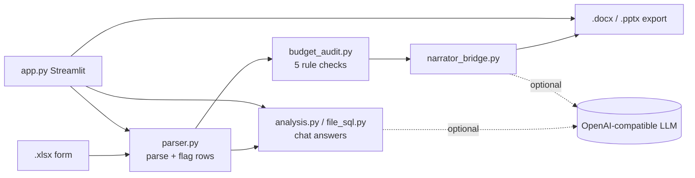

# IT Budget Auditor

Chat-first Streamlit prototype that audits corporate IT-budget Excel forms: upload a workbook, get rule-based anomaly flags, ask follow-up questions in Russian, and export a draft review conclusion (.docx and .pptx).

## Why I built it

Reviewing subsidiaries' IT-budget forms was manual: open each Excel file, check quarter totals, year-over-year growth, supplier concentration and missing fields, then write the findings up by hand. This tool automates the mechanical part and leaves the judgement to the reviewer. It is a prototype; it was developed against sample forms and the repository contains no company data (tests generate their own synthetic workbooks).

## Features

- Parser for a multi-sheet budget form (OPEX/CAPEX, per-branch sheets): finds the header row, forward-fills budget codes, skips subtotal/footer rows, tolerates layout variants (with an optional LLM fallback for unrecognised headers).
- Five rule checks (`core/budget_audit.py`): quarters vs annual plan (>1% mismatch), year-over-year growth over a threshold, supplier concentration (>40% share), missing counterparty/contract/code/expense type, new line items.
- Chat over the uploaded file: deterministic answers for common questions (totals, top-N, concentration, comparison across years); optional LLM text-to-SQL fallback over the file's flat table.
- Export of a draft "Заключение" as an editable .docx (via the Node `docx` package) and .pptx (python-pptx).
- `legacy/`: the earlier procurement-comparison MVP on synthetic data (SQLite warehouse, rule-based and LLM query engine), kept with its tests.

## Architecture



`core/` has no Streamlit imports; `app.py` is the only UI.

## Tech stack

Python 3.11+, pandas, openpyxl, Streamlit, python-pptx, openai SDK (OpenRouter or any OpenAI-compatible endpoint), Node `docx` for Word export, pytest, uv.

## Quickstart

```bash
uv sync
npm ci                      # .docx export (and one test) need Node
uv run streamlit run app.py
```

Without an LLM key the audit rules and deterministic chat work; narrative and SQL fallback are disabled.

## Configuration

| Variable | Purpose | Default |
|---|---|---|
| `OPENROUTER_API_KEY` | OpenRouter provider | unset |
| `OPENROUTER_MODEL` | model slug | built-in default |
| `OPENROUTER_MAX_OUTPUT_TOKENS` | output cap | `2000` |
| `LOCAL_LLM_BASE_URL` | OpenAI-compatible endpoint (vLLM, TGI) | unset |
| `LOCAL_LLM_API_KEY` / `LOCAL_LLM_MODEL` | credentials / model for that endpoint | unset |

See `.env.example`.

## Testing

```bash
uv run pytest -m "not api"     # 264 tests, no network (needs `npm ci` first)
```

Two tests under `legacy/` are marked `api` and call a live provider; they skip when none is configured.

## Project structure

```
app.py                      Streamlit UI
core/budget_auditor/        parser, chat analysis, file-level SQL, layout fallback, narrator bridge
core/budget_audit.py        rule checks
core/corporate_ingest.py    older sheet extractor (also a CLI)
core/conclusion_*.py        .docx / .pptx export
scripts/render_conclusion.js  Word renderer
legacy/                     earlier synthetic-data procurement comparison MVP
tests/                      fixtures are built in code
```

## Status and limitations

- Prototype. UI text and LLM prompts are in Russian.
- Parser targets one corporate form family; other layouts may need the LLM fallback or code changes.
- `legacy/` is not wired into the app.
- The Word export needs Node and `npm ci`; without it the button is hidden.

## Licence

MIT, see `LICENSE`.
